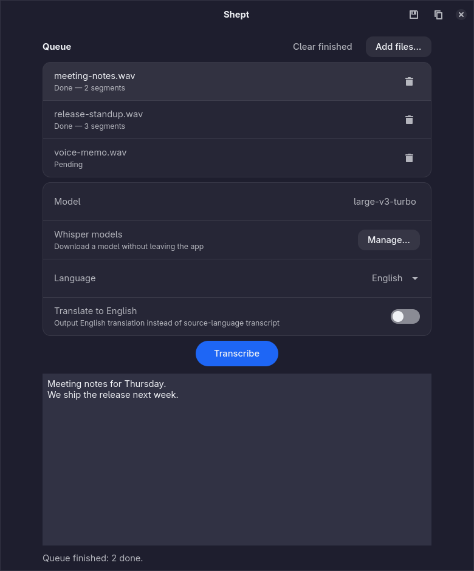

# Shept

*Shept* is Polish for "whisper", spelled the way it sounds.

Local speech-to-text for your desktop, powered by [whisper.cpp](https://github.com/ggml-org/whisper.cpp).



## Contents

- [What it does](#what-it-does)
- [Requirements](#requirements)
- [Install](#install)
- [Models](#models)
- [Usage](#usage)
- [How it works](#how-it-works)
- [Performance notes](#performance-notes)
- [Troubleshooting](#troubleshooting)
- [Status](#status)
- [Changelog](#changelog)
- [License](#license)

## What it does

- Add any audio or video file to a queue — mp3, wav, m4a, ogg, opus, flac,
  aac, mp4, mkv, mov, webm, avi, … — with the file dialog, drag & drop, or the
  command line
- Transcribe locally with a Whisper model of your choice, one file after
  another, so a batch can run unattended
- Download models from inside the app, with progress and cancellation
- Streams output as it transcribes, with a per-file progress bar and a summary
  when the batch ends
- Copy or save the selected file's transcript, or export every finished file
  at once — `.txt`, `.srt`, `.vtt`, `.lrc` or `.json`

Everything runs on your machine: no accounts, no uploads, no network access
during transcription. The only network access is a model download you start
yourself; no daemons or background processes either — `whisper-cli` is launched
on demand and exits when done, and the model is loaded into memory only for the
duration of a run.

Only file transcription is supported — there is no microphone / live mode.

## Requirements

- Python 3.10+
- GTK 4, libadwaita and PyGObject (`gi`) — system packages, not pip installs
- `ffmpeg` and `ffprobe`
- `whisper-cli` from whisper.cpp (1.7 or newer)

GPU acceleration is optional. A build of whisper.cpp with Vulkan support makes
transcription considerably faster than a CPU-only build on most modern GPUs
(AMD, Intel, NVIDIA); without it, whisper-cli falls back to the CPU.

## Install

Shept itself is one small Python package; the only real work is getting
`whisper-cli` onto your PATH.

### Fedora

The Fedora repositories ship only the whisper.cpp library, so use a COPR that
provides a CLI binary built with Vulkan enabled:

```bash
sudo dnf copr enable -y sneed/whisper-cpp-vulkan
sudo dnf install -y whisper-cpp ffmpeg python3-gobject gtk4 libadwaita
```

`ffmpeg` is in RPM Fusion Free; if you do not have RPM Fusion enabled you can
use `ffmpeg-free` from the main repositories instead.

### Debian / Ubuntu

`whisper.cpp` is not packaged in the distribution repositories and must be
built from source. The build takes only a few minutes:

```bash
# runtime + build dependencies
sudo apt install -y build-essential cmake git ffmpeg \
    python3-gi python3-gi-cairo gir1.2-gtk-4.0 gir1.2-adw-1 \
    libvulkan-dev glslc          # Vulkan build; skip these two for CPU-only

git clone https://github.com/ggml-org/whisper.cpp.git
cd whisper.cpp
cmake -B build -DGGML_VULKAN=1   # drop -DGGML_VULKAN=1 for a CPU-only build
cmake --build build -j --config Release

sudo install -Dm755 build/bin/whisper-cli /usr/local/bin/whisper-cli
sudo install -Dm755 build/src/libwhisper.so* /usr/local/lib/
sudo ldconfig
```

### Arch

Arch packages whisper.cpp as `whisper-cpp` (a CPU build). A Vulkan-enabled
build is also available from the AUR:

```bash
sudo pacman -S whisper-cpp ffmpeg python-gobject gtk4 libadwaita

# or, for the Vulkan build, with an AUR helper:
paru -S whisper.cpp-vulkan
```

### Other distributions

If no package exists for your distribution, build `whisper-cli` from source as
shown in the Debian/Ubuntu section above — the CMake steps are the same
everywhere. Make sure the resulting binary and any shared libraries are
reachable through `PATH` and the dynamic linker.

### Checking GPU acceleration

To see which backend whisper.cpp picked up, transcribe a short silent clip and
look at the startup output:

```bash
ffmpeg -hide_banner -loglevel error -f lavfi -i "anullsrc=r=16000:cl=mono" \
    -t 1 /tmp/silence.wav -y
whisper-cli -m /dev/null /tmp/silence.wav 2>&1 | grep -E "Vulkan|backend"
```

If the output mentions a Vulkan device and `whisper_backend_init_gpu`, GPU
acceleration is active. If it only mentions CPU, the Vulkan build was not
picked up — check that `vulkaninfo` reports your GPU and rebuild with
`-DGGML_VULKAN=1`.

## Models

Models are **not bundled** with Shept. Drop one (or more) `ggml-*.bin` files
into any of the directories Shept searches, in this order:

1. `$SHEPT_MODEL_DIR` — set this to keep models somewhere else entirely
2. `$XDG_DATA_HOME/shept/models` (`~/.local/share/shept/models`)
3. `$XDG_DATA_HOME/whisper-cpp/models` — whisper.cpp's own convention
4. `~/.cache/whisper.cpp/models` — older upstream default
5. `/usr/share/whisper-cpp/models`
6. `/usr/local/share/whisper-cpp/models`

Every `ggml-*.bin` file found in those directories shows up in the model
dropdown; if the same model exists in several places, the first directory wins.

### Downloading from the app

Open **Manage…** next to the model row to see the models Shept can fetch. Each
entry shows its size and what it is good for; press **Download** to fetch it.
Progress is shown per model, a download can be cancelled at any time, and
closing the window cancels the active transfer. A finished model appears in the
model dropdown immediately and is selected — no restart needed.

Downloads always go to `$XDG_DATA_HOME/shept/models`, which is
`~/.local/share/shept/models` by default. That is the first directory Shept
searches and the only model directory that is writable inside the Flatpak
sandbox, so a model downloaded there is visible to both the Flatpak and a
source checkout. A transfer is written as `ggml-<model>.bin.part` and only
renamed once it is complete, so an interrupted download never shows up in the
dropdown; the partial file is deleted on failure or cancellation. There is no
checksum to verify against — HuggingFace does not publish per-file hashes — so
Shept only checks the downloaded size against the published one.

Recommended: **`large-v3-turbo`** (~1.62 GB, f16) — the best accuracy/speed
balance for most languages, including non-English ones.

To download by hand instead:

```bash
mkdir -p ~/.local/share/shept/models
cd ~/.local/share/shept/models
curl -LO https://huggingface.co/ggerganov/whisper.cpp/resolve/main/ggml-large-v3-turbo.bin
```

Available models:

| Model                 | File size | Quality     | Speed       |
| --------------------- | --------- | ----------- | ----------- |
| `large-v3-turbo`      | 1.62 GB   | excellent   | very fast   |
| `large-v3-turbo-q5_0` | 0.57 GB   | excellent   | very fast   |
| `small`               | 0.49 GB   | acceptable  | fast        |
| `medium`              | 1.53 GB   | good        | medium      |
| `large-v3`            | 3.09 GB   | best        | slower      |
| `base`                | 0.15 GB   | poor        | very fast   |
| `tiny`                | 0.08 GB   | poorest     | very fast   |

Substitute `ggml-<model>.bin` in the URL above for any of these. Avoid the
`.en` variants unless you only ever transcribe English — they are
English-only.

If you installed the Fedora COPR package, it also ships a download helper:

```bash
whisper-cpp-download-model large-v3-turbo ~/.local/share/whisper-cpp/models
```

## Usage

Run from a source checkout:

```bash
python3 -m shept
```

Once installed (`pip install .`), the same thing is available as the `shept`
command.

1. **Add files…** queues one or more audio or video files. Dropping files onto
   the window works too, as does passing them on the command line
   (`python3 -m shept a.mp3 b.wav`) or opening them from the desktop. Files
   that are already in the queue, and paths that are not regular files, are
   skipped instead of queued twice.
2. Pick a **Model** (`large-v3-turbo` is selected automatically if present).
   Press **Manage…** to download one if the list is empty or you want another.
3. Pick the source **Language** (defaults to your system locale when Shept
   supports it, otherwise auto-detect)
4. Click **Transcribe all** — the button reads **Transcribe** when exactly one
   file is waiting. Files are processed one at a time: the active row shows
   `Transcribing…` with its own progress bar, the overall progress bar tracks
   the current file, and finished rows are marked `Done — N segments`.
   **Cancel** abandons the file that is running (it is marked `Cancelled`) and
   leaves the rest pending, so pressing **Transcribe all** again resumes the
   queue where it stopped.
5. Select a row to read that file's transcript in the text view. The running
   file is selected automatically, and switching rows keeps everything that
   was already transcribed — segments stay attached to their file.
6. Use the toolbar buttons to **copy** the selected transcript as plain text,
   or open the **save** menu:
   - **Selected file** writes that one transcript in the chosen format:
     `.txt` (plain text), `.srt` and `.vtt` (subtitles, with the timestamps
     whisper.cpp reported), `.lrc` (lyrics) or `.json` (timed segments,
     versioned schema). The menu entry decides the content; the filename you
     type in the dialog does not affect it.
   - **Export all…** asks for a folder and writes every finished file into it
     as `<file name>.<ext>`, appending ` (2)`, ` (3)` when two files share a
     name. It uses the format you last picked in **Selected file** (plain text
     until you pick one), and skips files that produced no text.
7. **Clear finished** removes completed, failed and cancelled rows from the
   queue without touching anything on disk.

### Translating a transcript

Shept does not translate. Whisper's built-in translation only produces English
and is considerably worse than dedicated machine translation. If you need
another language, export the transcript as subtitles (`.srt`) and translate
that file with the tool of your choice — DeepL, for instance, accepts `.srt`
and keeps the timestamps intact.

### Desktop launcher (optional)

To get Shept into your application menu, drop a desktop entry at
`~/.local/share/applications/io.github.psampir.Shept.desktop`:

```ini
[Desktop Entry]
Type=Application
Name=Shept
GenericName=Audio Transcription
Comment=Local audio transcription with whisper.cpp
Exec=shept %U
Icon=io.github.psampir.Shept
Terminal=false
Categories=AudioVideo;Utility;
Keywords=transcribe;transcription;whisper;speech;audio;text;
StartupNotify=true
StartupWMClass=io.github.psampir.Shept
MimeType=audio/mpeg;audio/x-wav;audio/mp4;audio/ogg;audio/opus;audio/flac;audio/x-flac;audio/aac;video/mp4;video/webm;video/x-matroska;video/quicktime;video/x-msvideo;video/x-ms-wmv;video/mp2t;video/x-m4v;video/3gpp;
```

`Exec=shept %U` assumes the package is installed; when running from a source
checkout without installing, use `Exec=python3 -m shept %U` instead (and set
`Path=` to the checkout directory).

Then refresh the launcher cache (most desktops do this automatically):

```bash
update-desktop-database ~/.local/share/applications/
```

## How it works

Every file in the queue goes through the same two stages. `ffmpeg` decodes it
to a temporary 16 kHz mono WAV file, then `whisper-cli` transcribes that WAV and
Shept parses the timestamped segments from its output as they arrive. Each
segment keeps its start and end time: the text is appended to the text view, the
end time drives the progress bars, and the stored segments are what the
subtitle, lyrics and JSON exports are built from.

Files are transcribed strictly one after another. Decoding and whisper-cli are
already CPU/GPU-bound, so running two of them at once would make both slower and
the progress bars meaningless. Each file's temporary WAV is removed as soon as
its run ends. If a file fails — an unreadable container, a missing codec, a
non-zero exit from whisper-cli — its row is marked `Failed` with the reason and
the batch continues with the next file instead of stopping.

## Performance notes

- Reading the source file is often the bottleneck for large videos stored on
  network mounts. Copy the file to local disk first if it feels slow.
- `whisper-cli` only runs while a file is being transcribed. The GUI process
  itself idles at around 80 MB of RAM and negligible CPU.
- Each file costs one model load, because whisper-cli is a fresh process per
  file. A long batch is therefore cheaper per minute than a short one, and a
  queue of many short clips spends a noticeable share of its time loading the
  model.
- Quantized models (`*-q5_0`, `*-q8_0`) roughly halve memory use with
  negligible quality loss.
- GPU acceleration depends on the whisper.cpp build and the drivers, not on
  Shept; a CPU-only build still works, just slower.

## Troubleshooting

**"whisper-cli not found in PATH"** — install it (see [Install](#install)) and
make sure `which whisper-cli` returns a path. Shept shows the missing tool in a
banner at the top of the window together with the install command for your
distribution, and keeps **Transcribe all** disabled until it is available.

**"ffmpeg not found in PATH"** — install `ffmpeg` with your distribution's
package manager; the same banner explains how.

**One row says "Failed: …"** — that file could not be processed (damaged or
unsupported container, missing codec, whisper-cli exited non-zero); the reason
from the failing tool is in the row. The rest of the queue keeps running.
Remove the row, fix the file, and add it again.

**Model dropdown shows "(no models found)"** — no `ggml-*.bin` file was found in
any of the directories listed under [Models](#models); the window lists the
paths it searched. Press **Manage…** to download one from inside the app, or
drop a file there by hand. Filenames must start with `ggml-` and end with
`.bin`. Set `SHEPT_MODEL_DIR` if your models live elsewhere.

**No GPU acceleration / very slow** — see *Checking GPU acceleration* above.
On Debian/Ubuntu, double-check that you built with `-DGGML_VULKAN=1` and that
`libvulkan-dev` was installed.

**Output is garbled or English-looking for a non-English language** — you are
probably using a `.en` model. Pick a multilingual one (any model name without
an `.en` suffix).

**Random nonsense at the end of long files** — Whisper sometimes hallucinates
during silence. Trim trailing silence with ffmpeg (`-af silenceremove`) or
clean it up manually.

## Status

Shept is pre-release software under active development. Development happens on
the `dev` branch; `main` only carries released versions. The interface,
packaging and supported platforms may change without notice.

## Changelog

Released versions are documented in [CHANGELOG.md](CHANGELOG.md); the
`[Unreleased]` section there collects what has landed on `dev` since the last
tag.

## License

MIT — see [LICENSE](LICENSE). `whisper.cpp` and the Whisper models are
distributed under their own licenses (MIT for whisper.cpp); none of them are
bundled with Shept.
